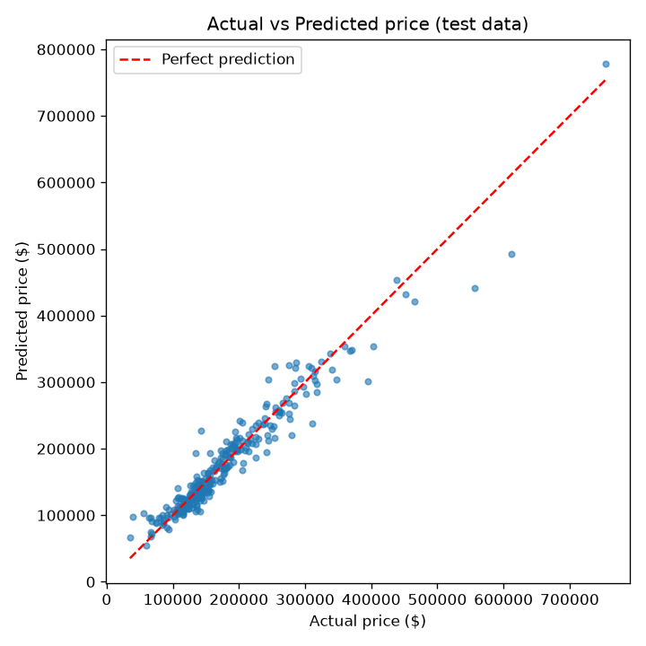
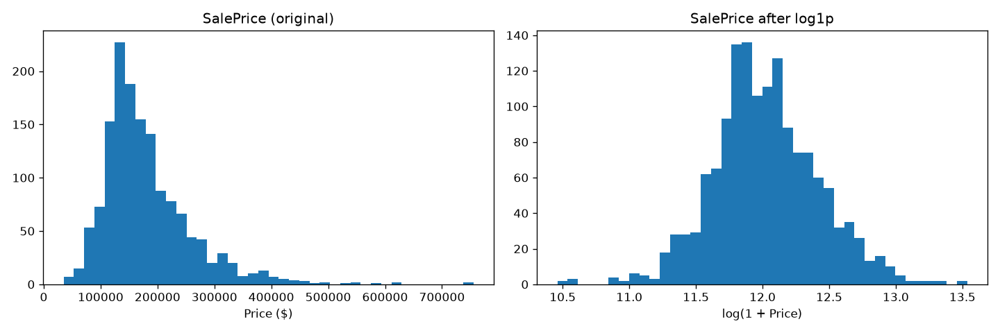
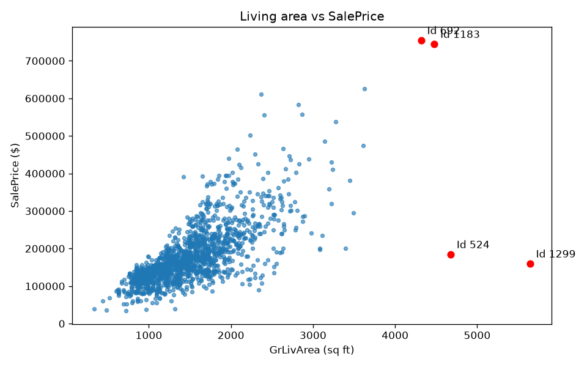
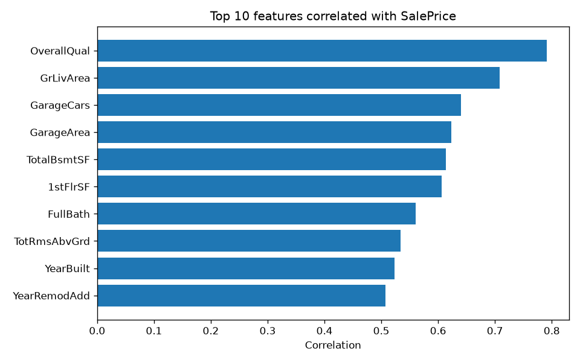
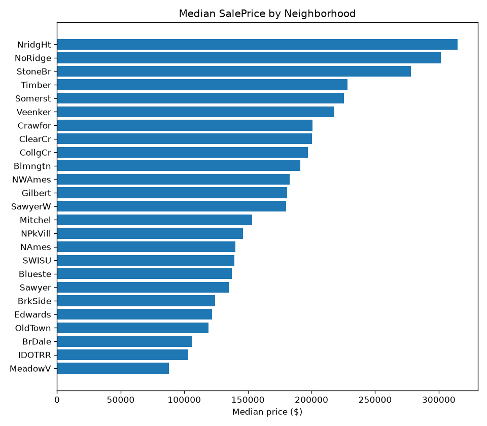
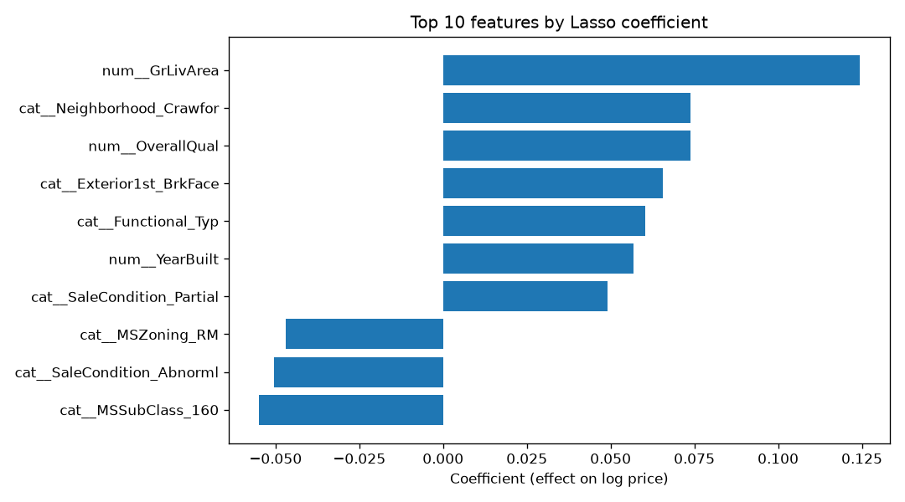

# House Price Prediction

**Estimate the sale price of a house from its size, quality, age and neighborhood, with an honest report of where the model can and cannot be trusted.**




## Table of Contents

- [Overview](#overview)
- [Key Features](#key-features)
- [Tech Stack](#tech-stack)
- [Dataset](#dataset)
- [Key Insights](#key-insights)
- [Approach](#approach)
- [Results](#results)
- [Error Analysis and Limitations](#error-analysis-and-limitations)
- [Installation and Usage](#installation-and-usage)
- [Example](#example)
- [Project Structure](#project-structure)
- [Future Improvements](#future-improvements)
- [Author](#author)
- [License](#license)
- [Acknowledgements](#acknowledgements)

## Overview

A property valuation company wants a fast, consistent price estimate for new listings, and wants to know which features drive the price. This project is a simulated client scenario on real data: 1,460 house sales in Ames, Iowa (2006-2010).

The final model (Lasso regression) reaches **R² 0.9377** and a mean absolute error of **$14,401** on 292 houses it never saw during training.

## Key Features

- Careful data cleaning: the text value `NA` is treated by its real meaning ("feature not present") instead of "missing"
- No data leakage: the data is split first, and all preprocessing is fitted on training data only, inside one scikit-learn pipeline
- 7 models compared with 5-fold cross-validation against a simple baseline
- Hyperparameter tuning with grid search, and a train-vs-CV check for overfitting
- Test set used once, plus an error analysis of the worst predictions
- Saved model and a menu app with validated inputs to predict a new house price
- Honest limitations section

## Tech Stack

| Area | Tools |
| --- | --- |
| Language | Python 3.13 |
| Data | pandas 3.1.1, numpy 2.5.4 |
| Modeling | scikit-learn 1.9.1, scipy 1.18.1 |
| Graphs | matplotlib 3.11.2, seaborn 0.13.2 |
| Model saving | joblib 1.6.0 |
| Workflow | venv, Git |

## Dataset

- Source: [Kaggle - House Prices: Advanced Regression Techniques](https://www.kaggle.com/competitions/house-prices-advanced-regression-techniques)
- 1,460 rows, 81 columns (79 features + `Id` + `SalePrice`)
- The data is not included in this repository. Download `train.csv` from Kaggle and place it in a folder named `data/`.

## Key Insights

1. `SalePrice` is right-skewed (skew 1.88). After `log1p` the skew is 0.12, so the model is trained on `log1p(SalePrice)`.
2. Two houses (Id 524 and 1299) are very large (4,676 and 5,642 sq ft) but sold for only $184,750 and $160,000. Both are `SaleCondition = Partial` (home not finished at sale). They are removed from the training set only.
3. The numeric features most correlated with price are `OverallQual` (0.79) and `GrLivArea` (0.71). Several features overlap (for example `GarageCars` and `GarageArea`), so regularized models were tested.
4. Neighborhood matters: the median price ranges from $88,000 (MeadowV) to $315,000 (NridgHt).
5. In this dataset `NA` usually means "feature not present" (no pool, no garage), not missing data. It is handled separately from the 7 columns that have truly missing values.






## Approach

1. Read the data with `keep_default_na=False` and clean `NA` values according to their real meaning.
2. Split 80% train / 20% test (`random_state=42`) **before** any learning from the data, to avoid data leakage.
3. Preprocessing in one scikit-learn pipeline, fitted on training data only:
   - numeric columns: median imputation (with missing-value indicators) and scaling
   - ordered quality columns: ordinal encoding in the correct order
   - other categorical columns: one-hot encoding
4. Compare 7 models with 5-fold cross-validation on the training set.
5. Tune the best linear model (Lasso) and the best tree model (Gradient Boosting) with grid search.
6. Evaluate the final model once on the untouched test set.

## Results

Cross-validation (training set, RMSE on log price, lower is better):

| Model | CV RMSE |
| --- | --- |
| Lasso | 0.1117 |
| ElasticNet | 0.1120 |
| Ridge | 0.1131 |
| Gradient Boosting | 0.1220 |
| Linear Regression | 0.1350 |
| Random Forest | 0.1365 |
| Baseline (mean price) | 0.3906 |

Tuning: Lasso (alpha 0.001) has train RMSE 0.1020 vs CV 0.1117, a small gap. Gradient Boosting after tuning has train RMSE 0.0483 vs CV 0.1168, which shows overfitting. Lasso was chosen as the final model.

**Final model: Lasso, on the test set (292 houses):**

| Metric | Value |
| --- | --- |
| RMSE (log price) | 0.1297 |
| MAE | $14,401 |
| R² (price in $) | 0.9377 |



The strongest positive features are living area (`GrLivArea`), overall quality (`OverallQual`), the Crawfor neighborhood and brick-face exterior. Year built also adds to the price, but less. Abnormal sales (`SaleCondition_Abnorml`) lower the price. Lasso set 193 of 268 encoded features to zero.

## Error Analysis and Limitations

- The model underestimates very expensive houses: the three largest errors are houses sold for $395,000 to $612,000, predicted 19% to 24% too low.
- It overestimates some very cheap houses: a $40,000 house in IDOTRR was predicted at $97,417.
- Predictions outside the data range are unreliable (for example houses above 4,000 sq ft, or a combination of size, age and neighborhood that never occurs in the data).
- The data covers one city (Ames, Iowa) and sales from 2006 to 2010. It should not be used for other cities or current prices without retraining.
- The prediction menu asks for only 4 details (area, quality, year built, neighborhood). All other details are assumed typical for the whole dataset, so these estimates are rough. Changing only the neighborhood changes the estimate very little for this reason.
- The saved model is trained on the training split only (80% of the data).

## Installation and Usage

```
git clone https://github.com/Charan-Code600/House-Price-Prediction.git
cd House-Price-Prediction
python -m venv venv
venv\Scripts\activate
pip install -r requirements.txt
```

Put `train.csv` in the `data/` folder, then run:

```
python main.py
```

Menu: 1 data quality report, 2 EDA graphs, 3 compare models, 4 train/evaluate/save the final model, 5 predict a house price, 6 exit. Run option 4 once before using option 5.

Results are reproducible: `random_state=42` and the library versions are pinned in `requirements.txt`.

## Example

Option 5 (predict a house price) with these inputs:

| Input | Value |
| --- | --- |
| Living area | 1800 sq ft |
| Overall quality (1-10) | 7 |
| Year built | 2005 |
| Neighborhood | CollgCr |

Estimated price: **$188,978**. The menu rejects values outside the range seen in the data (area 300-6000, quality 1-10, year 1870-2010).

## Project Structure

```
House-Price-Prediction/
 ├─ data/               (not in the repository)
 ├─ models/             (saved model, created by option 4)
 ├─ reports/figures/    (graphs)
 ├─ src/
 │   ├─ config.py       settings and column groups
 │   ├─ data_loader.py  reading and cleaning data
 │   ├─ eda.py          exploratory graphs
 │   ├─ preprocess.py   split and preprocessing pipeline
 │   ├─ train.py        model comparison, tuning, saving
 │   ├─ evaluate.py     test metrics, error analysis, graphs
 │   └─ predict.py      load model and predict
 ├─ main.py             menu
 ├─ requirements.txt
 ├─ LICENSE
 └─ README.md
```

## Future Improvements

- Retrain the final model on all labeled data before delivery
- Ask for more house details in the prediction menu to get tighter estimates
- Add prediction ranges (for example a typical error band) instead of a single number
- Try stacking or other models for the most expensive houses
- Add automated tests
- Deploy as a web app (live demo link will be added here after deployment)

## Author

**Charan**, self-taught AI/ML developer, Pune, India

- GitHub: [Charan-Code600](https://github.com/Charan-Code600)
- LinkedIn: [charanaade](https://www.linkedin.com/in/charanaade)

## License

This project is released under the MIT License. See the `LICENSE` file.

## Acknowledgements

The Ames Housing dataset was compiled by Dean De Cock and is available through Kaggle.


